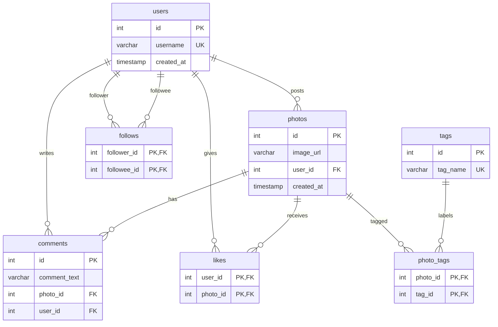

# MySQL Bootcamp

My SQL work from **[The Ultimate MySQL Bootcamp: Go from SQL Beginner to Expert](https://www.udemy.com/course/the-ultimate-mysql-bootcamp-go-from-sql-beginner-to-expert/)** (Colt Steele, Udemy): schemas, exercises and queries, written and run against MySQL 8.4.

<!-- CERTIFICATE -->

## What's inside

| Folder | Topics |
| --- | --- |
| [`01-crud-basics`](01-crud-basics) | `CREATE DATABASE/TABLE`, data types, `NOT NULL`, `DEFAULT`, `PRIMARY KEY`, `AUTO_INCREMENT`, `INSERT`, `SELECT`, `UPDATE`, `DELETE` |
| [`02-one-to-many`](02-one-to-many) | Foreign keys, `ON DELETE CASCADE`, subqueries, `INNER` / `LEFT` joins, `GROUP BY` across joins, `IFNULL`, `IF()` |
| [`03-many-to-many-and-views`](03-many-to-many-and-views) | Junction tables, 3-table joins, `MIN`/`MAX`/`AVG`/`COUNT`, `CASE`, finding unmatched rows, `CREATE` / `ALTER` / `REPLACE VIEW` |
| [`04-window-functions`](04-window-functions) | `OVER()`, `PARTITION BY`, `RANK`, `DENSE_RANK`, `ROW_NUMBER`, `NTILE`, `FIRST_VALUE`, `LAG`, `LEAD` |
| [`05-instagram-clone`](05-instagram-clone) | Final project: a 7-table social media schema with composite keys and a self-referencing follows table |

## Instagram clone schema



## Highlights

**Reviewer stats with `LEFT JOIN`, aggregates and `CASE`** ([tv_reviews.sql](03-many-to-many-and-views/tv_reviews.sql))

```sql
SELECT first_name, last_name,
       COUNT(rating)                    AS count,
       IFNULL(MIN(rating), 0)           AS min,
       IFNULL(MAX(rating), 0)           AS max,
       ROUND(IFNULL(AVG(rating), 0), 2) AS average,
       CASE WHEN COUNT(rating) > 0 THEN 'ACTIVE' ELSE 'INACTIVE' END AS status
FROM reviewers
LEFT JOIN reviews ON reviewers.id = reviews.reviewer_id
GROUP BY reviewers.id, first_name, last_name;
```

**Ranking within and across groups** ([employees_salaries.sql](04-window-functions/employees_salaries.sql))

```sql
SELECT emp_no, department, salary,
       RANK()       OVER (PARTITION BY department ORDER BY salary DESC) AS dept_salary_rank,
       DENSE_RANK() OVER (ORDER BY salary DESC)                         AS overall_dense_rank
FROM employees;
```

**Pay gap to the next-highest earner in the department, using `LAG`**

```sql
SELECT emp_no, department, salary,
       salary - LAG(salary) OVER (PARTITION BY department ORDER BY salary DESC) AS salary_diff
FROM employees;
```

## Running it

Each file creates its own database, so you can run them in any order (MySQL 8+ is required for the window functions):

```bash
mysql -u root -p < 03-many-to-many-and-views/tv_reviews.sql

# Instagram clone with the full dataset (100 users, 257 photos)
mysql -u root -p < 05-instagram-clone/data/ig_clone_data.sql
mysql -u root -p < 05-instagram-clone/queries.sql
```

`05-instagram-clone/data/ig_clone_data.sql` is the dataset that comes with the course.
